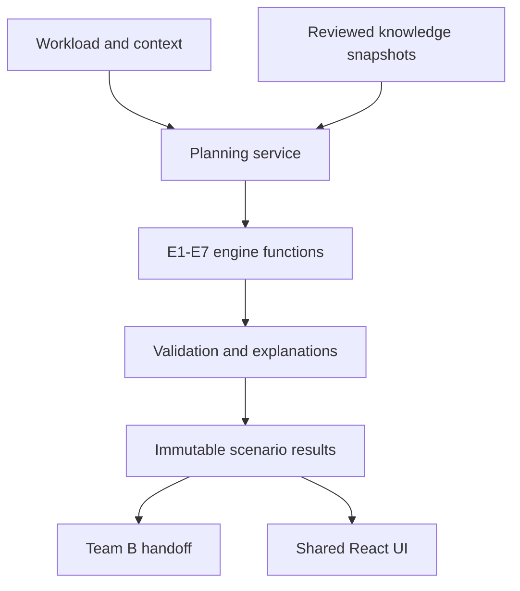

# Architecture and source reconciliation

## Canonical naming
Use E1 workload, E2 performance, E3 infrastructure recommendation, E4 sizing, E5 power/energy, E6 engineering cost and E7 validation/risk from the full PDF. The older JPEG groups functions differently; its sixth box is a DSS decision engine, not the same E6. Physics workbook owner aliases ENG-06/ENG-07 and subject phase numbers are retained as source aliases, not API routing IDs.

## Design
Start with one Team C Python package and one FastAPI service. Each engine is a pure typed function/module with explicit data dependencies. A planning service orchestrates them; repositories handle persistence; schemas validate all inputs and outputs. Separate deployable services for each individual engine would create avoidable operational work at this stage. Team A/B can remain separate team services with versioned contracts.

## Proposed folders
`team_c/src/wisp_team_c/` contains domain contracts, engine functions, adapters and orchestration. `tests/` contains numerical/contract/import fixtures. `contracts/` contains generated schemas and shared accepted interface fixtures. `database/` holds reviewed migrations. `data/` holds privacy-filtered provenance schemas, never private raw copies. `docs/` holds specifications and source review. `frontend/` is a temporary Team C workbench; central integration must reuse the single shared UI instead of creating three competing frontends.

## Dependency graph
| Engine | Needs | Invalidated by |
|---|---|---|
| E1 | Workload/model identity, candidate benchmarks, user priorities | Workload/model/version or eligible candidate changes |
| E2 | Selected workload, deadline/throughput/latency/availability targets | QoS or benchmark interpretation changes |
| E3 | E1/E2 constraints, catalogue snapshot, compatibility evidence | Hardware/version/constraints changes |
| E4 | E3 candidates, E2 demand, rack/network/storage limits | Candidate quantities/room/rack layout changes |
| E5 | E4 bill of resources, operating load basis, time series, facility method | Equipment/load/PUE/Team B power model changes |
| E6 | E4 quantities, E5 energy, dated prices/tariff and horizon | Quantity, energy, currency, quote or horizon changes |
| E7 | All applicable requirements and engine results | Any input/engine/evidence change |

Recompute all downstream dependents after a change. Begin with full deterministic recomputation for small datasets; add cached DAG execution only after proving equivalence against a full rerun. What-if results use separate scenario IDs and parent linkage.

## Team boundaries and coupling
Team A sends regional context with year, geography, units and provenance. Team C sends IT load, operating/peak/rated basis, racks/resources and heat location to Team B. Team B returns cooling configuration, modeled cooling power and assumptions. Choose either a PUE factor or explicit component overhead for a given run. Never add Team B cooling power to a facility demand already estimated by PUE. A coupled iteration must record convergence tolerance, iteration cap and nonconverged status; a finite iterative cycle is not an unnoticed dependency loop.

## Retrofit R1-R6
R1 records installed equipment/age/capacity; R2 evaluates current workload, performance, power and efficiency using E2/E4/E5; R3 compares current and target requirements; R4 evaluates compatible upgrades; R5 validates interfaces, downtime and shared failure paths; R6 creates prioritized staged upgrade outputs. R1-R6 cannot create reliable savings/ROI without measured baseline and supported future scenario, quote and horizon. Retain these modules in design; scope decision is OPEN.

## Current starter
`contracts.py`, `physics.py` and `api.py` implement a small E5 calculation slice. The database is configured as an optional local profile with initial schema; API persistence, orchestrator, candidate imports and full E1-E7 implementation are pending. The health response makes this explicit.
